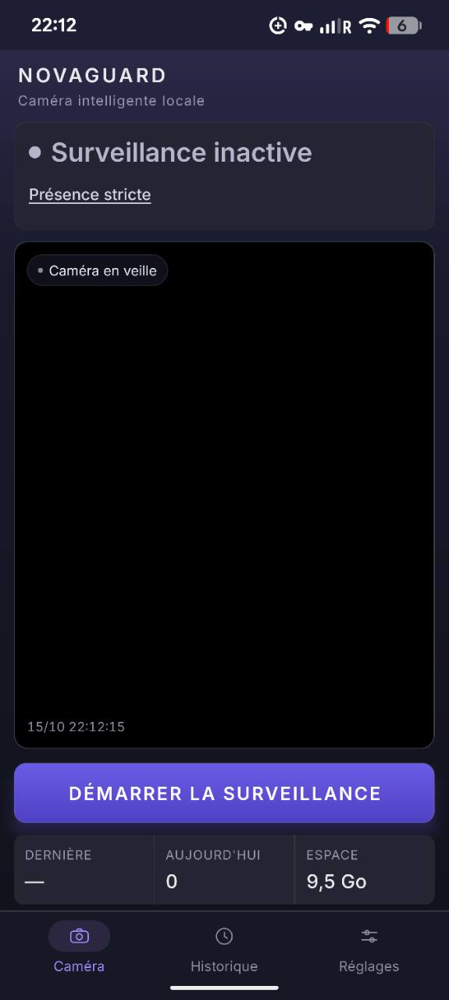
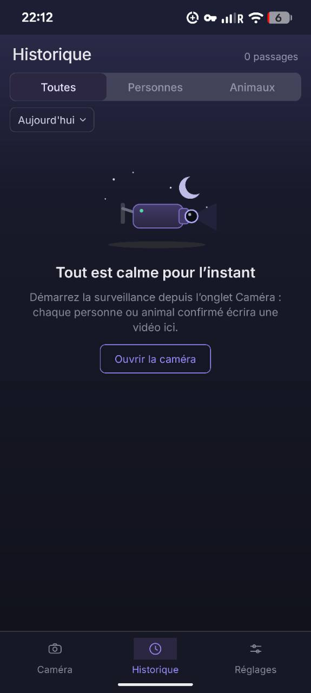
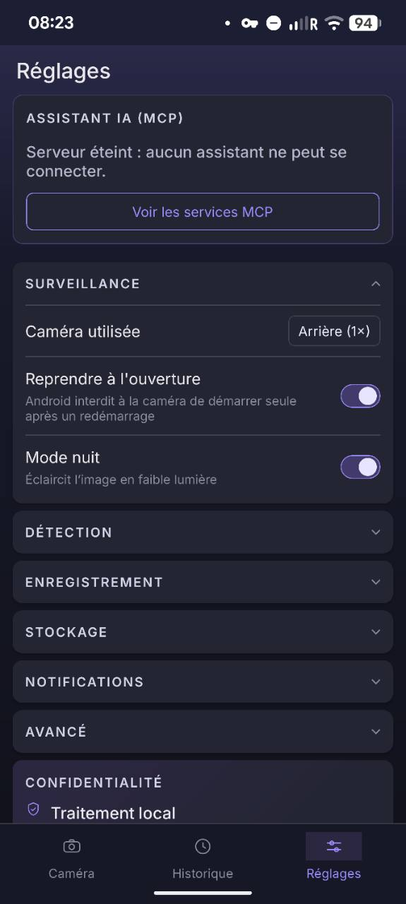

# NovaGuard

Caméra de surveillance intelligente, locale et open source. NovaGuard transforme un smartphone Android en caméra de détection de personnes et d'animaux — toute la détection et l'enregistrement restent sur l'appareil, rien n'est envoyé vers un serveur.

[](https://devdownin.github.io/novaguard/)
[](https://github.com/devdownin/novaguard/actions/workflows/ci.yml)
[](LICENSE)

## Version 1.1.0

La 1.1.0 est préparée dans la [PR #113](https://github.com/devdownin/novaguard/pull/113). Au 16 octobre 2026, aucun tag ni APK `v1.1.0` n’est publié ; le dernier APK stable disponible est `v0.9.5`. Le [site](https://devdownin.github.io/novaguard/#installer) affiche la version du fichier proposé au téléchargement.

- **Alertes avec image** : le texte arrive immédiatement, puis l’image complète la même notification sans deuxième sonnerie. L’image reste masquée tant que le téléphone est verrouillé ; cette alerte n’est pas relayée à une montre.
- **Passages répétés** : un retour pendant la minute de délai met à jour silencieusement l’alerte encore affichée, avec le nombre de passages des dix dernières minutes. Son image reste celle du premier passage ; une alerte balayée ne réapparaît pas.
- **Heures calmes** : une plage horaire suspend les alertes tout en conservant la détection et l’enregistrement des passages.
- **Zones ignorées** : jusqu’à trois rectangles pour écarter certaines parties de la scène, selon la position des pieds du sujet.
- **Configuration visible par MCP** : l’agent peut consulter le nombre de zones ignorées, l’option d’image dans l’alerte et les heures calmes via `get_configuration`.
- **Prise en main** : récupération de la liste des caméras au démarrage, état de démarrage explicite et actions vidéo renommées **Garder** et **Effacer**.

Voir le [guide de la version 1.1](docs/VERSION_1_1.md) pour les réglages, les limites et le statut de publication. Les essais matériels restent à effectuer selon [`docs/DEVICE_CHECKS.md`](docs/DEVICE_CHECKS.md).

## Aperçu de l’application

Captures Android réelles, conservées sans retouche. Cliquer sur une image l’ouvre en taille réelle.

| Surveillance | Historique | Réglages et assistant IA |
| :---: | :---: | :---: |
| <a href="site/assets/screens/surveillance.jpg"></a> | <a href="site/assets/screens/historique.jpg"></a> | <a href="site/assets/screens/reglages.jpg"></a> |

L’historique montre un passage et son emplacement dans la journée. Le bloc **Assistant IA (MCP)** des réglages indique ici que le serveur est éteint ; **Voir les services MCP** ouvre la liste des capacités sans l’activer. La capture Surveillance, prise séparément, montre la caméra en veille.

[Découvrir l’application sur le site](https://devdownin.github.io/novaguard/#apercu) · [Connecter un agent avec le guide MCP](https://devdownin.github.io/novaguard/guide-mcp.html)

## Fonctionnalités

- **Surveillance** — flux caméra en direct, indicateur d'état, démarrage/arrêt en un geste, dernières statistiques (dernière détection, détections du jour, espace disponible).
- **Détection sur l'appareil** — personnes et animaux, reconnus en local par EfficientDet-Lite0 (TensorFlow Lite, COCO) sur **tout** le champ de vision et sur une image redressée. Suivi multi-sujets : chaque personne présente est encadrée, avec son niveau de confiance. La confirmation dépend de la sensibilité. Le suivi tolère les occlusions ; le mode strict découpe les fichiers selon les observations positives.
- **Zones ignorées** — jusqu’à trois rectangles dans Réglages → Détection, en complément de la zone de détection. Les décisions utilisent le point bas du sujet (ses pieds) : la position de ce point détermine l’exclusion.
- **Zoom auto sur les personnes** — quand quelqu'un est détecté, le cadrage glisse doucement sur cette personne **entière**, de la tête aux pieds, s'y maintient 4 s, puis revient en plan large sur toute la scène et s'y pose avant qu'un nouveau plan serré soit permis. Un visage détecté (ML Kit) ne sert qu'à choisir qui regarder quand plusieurs personnes sont dans le champ : quelqu'un de dos ou dans le noir est suivi de la même façon. Mouvement animé sur le driver natif, donc insensible à la charge de l'inférence. Ce mouvement reste dans l’aperçu : la détection et la vidéo conservent tout le champ de la caméra. Désactivable dans Setup → Détection.
- **Enregistrement** — chaque détection confirmée écrit un clip MP4 (H.264) nommé d'après ce qui l'a déclenché — `Personne_2026-09-02_14-32-07.mp4` — dans le stockage privé de l'application. Un enregistrement ne démarre jamais sans sujet confirmé, et un clip qu'aucun évènement ne réclame est supprimé plutôt que laissé sur disque : aucune permission de stockage, rien dans la galerie partagée, tout disparaît à la désinstallation. La qualité (720p/1080p/4K), la durée après détection et la durée maximale d'un clip sont réglables ; au-delà du maximum le clip est coupé et la suite enregistrée dans un segment suivant.
- **Partager un clip, exporter une preuve** — les enregistrements restent dans le répertoire privé de l'application, qu'aucune autre app ne peut lire ; le bouton « Partager » du détail d'un évènement ouvre le sélecteur Android et offre **ce fichier-là**, par une URI temporaire. « Exporter comme preuve » remet d'un coup **tous les clips du passage** et un rapport texte : horaires, genres vus, segments manquants et empreinte SHA-256 de chaque fichier, avec la commande pour la vérifier. Rien ne sort sans ce geste.
- **Surveillance en arrière-plan** — un service de premier plan de type `camera` (plus `microphone` quand la permission est accordée) démarre avec la surveillance : Android autorise alors la caméra hors écran et ne ferme pas le processus. Une notification permanente et silencieuse indique que la caméra est active ; elle est masquée sur l'écran verrouillé.
- **Gestion du stockage** — rétention configurable (1 à 90 jours, ou toujours), suppression automatique des clips les plus anciens quand le volume passe sous 500 Mo libres, espace réellement mesuré sur l'appareil, et nettoyage au démarrage des fichiers qu'aucun évènement ne référence plus.
- **Alertes** — notification à l’ouverture d’une détection, avec une minute minimum entre deux sonneries. L’option « Image dans l’alerte » ajoute l’image après le texte, sans nouvelle sonnerie ; elle reste masquée sur l’écran verrouillé. Les heures calmes suspendent les alertes sur une plage horaire sans interrompre les enregistrements. La 1.1.0 prépare aussi la mise à jour silencieuse de l’alerte lors des passages répétés (voir ci-dessus). Son et vibration se règlent dans les paramètres Android du canal.
- **Historique** — événements enregistrés sous forme de cartes, filtrables par type et par période, avec détail complet (lecture de la vidéo, confiance, taille réelle, suppression) en panneau.
- **Setup** — réglages de surveillance, détection, enregistrement, stockage, serveur MCP et notifications regroupés par sections repliables ; la sensibilité et le seuil de confiance pilotent directement le pipeline de détection.
- **Serveur MCP (Model Context Protocol)** — serveur sur l'appareil (port 8081 par défaut, spécification `2026-07-28`) pour un agent IA (ex. *Claude*, *Cursor*). Le serveur reste en dehors du chemin de détection temps réel ; la page « Ce qu'un assistant IA peut voir et faire » (Réglages) liste tout, et [`mcp.md`](mcp.md) le spécifie.
  - **Lecture** : historique, statistiques, statut et diagnostic de la caméra (`get_diagnostics`) ; images des passages (`get_event_frames`), recadrables sur le sujet ; attente du prochain évènement (`wait_for_event`) ; trois prompts prêts à l'emploi (rapport de la nuit, revue des alertes, diagnostic).
  - **Vue en direct** (interrupteur dédié, éteint par défaut) : une image de ce que voit la caméra, à la demande, sans rien enregistrer (`get_live_frame`).
  - **Pilotage** (autorisation explicite et jeton distinct, à durée limitée et révocable depuis la notification) : démarrer ou arrêter la surveillance, régler la sensibilité et les seuils, conserver un passage, acquitter une alerte, laisser un verdict sur un évènement que l'Historique affiche. Jamais rien supprimer ; chaque action est consignée sur l'appareil.
  - **Connexion** : DNS-SD sur le Wi-Fi, configuration en QR code, HTTPS en option sous une autorité propre au téléphone (clé dans l'Android Keystore).
- **Direct Wi-Fi local** — serveur désactivé par défaut ; lorsqu'il est activé, la caméra publie une image JPEG par seconde, accessible dans un navigateur avec un PIN de 12 chiffres généré sur l'appareil (identifiant Basic au choix). Utiliser uniquement sur un réseau local de confiance : la connexion HTTP ne chiffre ni le PIN ni les images.
- **Confidentialité par conception** — détection et enregistrement restent sur l'appareil. Les clips restent dans le stockage privé de l'application et les réglages et l'historique dans `AsyncStorage`. L'activation volontaire du direct Wi-Fi ou du serveur MCP ouvre un accès réseau local aux données correspondantes.
- **Premier lancement** — écran de démarrage animé (viseur, marque, trois piliers du produit) pendant l'hydratation de l'état persisté, avant l'onboarding.

> Plus aucun réglage de l'interface n'est décoratif : tout ce qui est affiché agit réellement, ou a été retiré. Rien n'a toutefois pu être exécuté sur un vrai capteur dans cet environnement de build (ni SDK Android ni émulateur) : la géométrie, la gestion du stockage et les règles d'alerte sont couvertes par des tests unitaires, mais la capture, l'orientation, l'alignement des cadres et tout le code natif restent à valider en conditions réelles — voir [Feuille de route](#feuille-de-route) et la liste des vérifications sur appareil, [`docs/DEVICE_CHECKS.md`](docs/DEVICE_CHECKS.md). Le workflow CI produit un APK installable pour ça.

## Surveiller et relire un passage

L’écran caméra affiche un état principal avec texte et couleur, puis le mode de capture. Toucher le mode ouvre directement son réglage. Les erreurs proposent une action : **Autoriser la caméra**, **Réessayer** ou **Libérer de l’espace**. La reprise automatique de la caméra est indiquée ; le bouton de stockage ouvre les contrôles et ne supprime aucune vidéo à lui seul.

Dans l’historique, les séquences d’une même présence sont réunies en un passage. Les passages mixtes restent visibles dans les filtres Personnes et Animaux, avec toutes leurs séquences. La durée agrégée est la somme des vidéos disponibles ; les séquences sans fichier sont signalées. Les clips anciens, sans identifiant de passage, restent indépendants.

**Lire les vidéos du passage** enchaîne les fichiers disponibles dans l’ordre de capture. Une erreur de lecture arrête la lecture et permet de réessayer la séquence concernée. Le partage et la suppression concernent la séquence affichée ; la suppression garde sa confirmation habituelle.

## Enregistrement limité aux présences

Pour une nouvelle installation, **Réglages → Enregistrement → Mode de capture** vaut **Présence stricte**. Ce mode strict conserve les images depuis la première observation du sujet, après confirmation, et demande la fermeture dès qu’aucun sujet confirmé n’est observé. Le délai du tracker n’étend pas la vidéo. Plusieurs personnes et animaux peuvent maintenir une même présence.

La caméra alimente un encodeur Android continu. Un tampon compressé reste uniquement en mémoire, limité à quatre secondes et 16 Mio. Les MP4 sont segmentés sur les images déjà encodées sans arrêter la capture ni redémarrer l’encodeur. La finalisation des fichiers utilise un thread distinct ; sa file est également bornée. L’audio AAC est inclus uniquement avec la permission microphone. Aucune scène vide n’est écrite dans un fichier de ce mode.

Le mode **Avec tolérance** propose une marge de **1 s** par défaut, réglable à **2 s** ou **3 s**. Il conserve le même clip si une présence revient dans cette marge, et inclut donc des images sans présence. Ces marges courtes utilisent le même encodeur continu. Le choix est mémorisé lorsqu’on revient au mode strict ; changer de mode ou de marge ferme le clip courant.

Les préférences existantes sont conservées. Les anciennes valeurs **5 s, 10 s et 30 s** restent disponibles avec le backend VisionCamera : leur délai commence après expiration du suivi (jusqu’à 1,2 s supplémentaires), avec ses interruptions de segmentation. Ce comportement est indiqué dans le réglage.

Le viseur, l’état de surveillance et la notification distinguent le démarrage, la surveillance active, l’enregistrement, la caméra indisponible, la détection indisponible et le stockage insuffisant. Une analyse qui ne répond plus depuis plus de trois secondes est signalée et ferme la sélection courante ; une panne ne s’affiche pas comme une scène vide.

La présence est une estimation échantillonnée : le logiciel ne connaît pas l’instant physique exact d’entrée ou de sortie entre deux analyses. Les vidéos restent limitées aux images disponibles, et la dernière image a une durée nominale de 1/30 s. Un passage jamais reconnu ne peut pas être récupéré. Si le tampon est épuisé, le début indisponible est signalé et les images restantes peuvent être enregistrées. Un encodeur incompatible avec les images indépendantes, une surcharge ou une erreur de stockage produit un diagnostic, sans passage silencieux au backend avec post-roll. La cadence et la continuité doivent être mesurées sur les appareils cibles, notamment en 4K et écran éteint.

Voir [la procédure de validation des présences](docs/PRESENCE_RECORDING.md).

## Stack technique

- [React Native](https://reactnative.dev) (CLI *bare*, sans Expo) — Android 16 (API 36) minimum ; `minSdk`, `compileSdk` et `targetSdk` sont tous à 36, donc un seul niveau de plateforme à supporter
- TypeScript
- [react-native-vision-camera](https://github.com/mrousavy/react-native-vision-camera) pour le flux caméra et les frame processors
- [react-native-fast-tflite](https://github.com/mrousavy/react-native-fast-tflite) pour l'inférence TensorFlow Lite embarquée (`assets/models/efficientdet-lite0.tflite`, quantifié uint8 320×320, et `efficientdet-lite2.tflite` en 448 px derrière le réglage « Détection étendue » — même labelmap COCO, licence Apache-2.0), avec délégué GPU et repli CPU automatique
- [react-native-vision-camera-face-detector](https://github.com/luicfrr/react-native-vision-camera-face-detector) (ML Kit) pour la détection de visages, qui désigne le sujet du zoom auto
- [vision-camera-resize-plugin](https://github.com/mrousavy/vision-camera-resize-plugin) et [react-native-worklets-core](https://github.com/margelo/react-native-worklets-core) pour le traitement des frames sur un thread dédié
- [react-native-svg](https://github.com/software-mansion/react-native-svg), [react-native-linear-gradient](https://github.com/react-native-linear-gradient/react-native-linear-gradient), [@react-native-community/slider](https://github.com/callstack/react-native-slider)
- [@dr.pogodin/react-native-fs](https://github.com/birdofpreyru/react-native-fs) pour les fichiers vidéo et l'espace disque, [react-native-video](https://github.com/TheWidlarzGroup/react-native-video) pour la lecture
- [@react-native-async-storage/async-storage](https://github.com/react-native-async-storage/async-storage) pour la persistance locale
- Police [Inter](https://rsms.me/inter/) (SIL OFL 1.1)

## Démarrage

Prérequis : suivre le guide [Set Up Your Environment](https://reactnative.dev/docs/set-up-your-environment) de React Native pour Android (JDK, Android Studio/SDK, un émulateur ou un appareil connecté).

```sh
git clone https://github.com/devdownin/novaguard.git
cd NovaGuard
npm install
npm run android
```

`npm start` lance Metro séparément si besoin. Voir aussi [`CONTRIBUTING.md`](CONTRIBUTING.md) pour le détail des scripts (`lint`, `test`, `tsc`).

### Récupérer un APK sans installer l'environnement Android

Le workflow [`CI`](.github/workflows/ci.yml) construit un APK installable après chaque fusion sur `main`, lors de la publication d'un tag de version (ex. `v1.0.0`, automatiquement joint à la *Release* GitHub), et à la demande sur n'importe quelle branche : onglet **Actions** → *CI* → **Run workflow** (choisir la branche), puis récupérer `novaguard-release-apk` dans les artefacts du run une fois terminé. Aucun secret de signature n'est nécessaire pour cet APK : il est signé avec le keystore de debug du dépôt, ce qui suffit à l'installer sur un appareil de test. Ce qui part sur le Play Store est un autre artefact — un *App Bundle* signé par une clé d'upload qui ne vit pas dans le dépôt — voir [Publication](#publication-sur-google-play).

## Publication sur Google Play

Le dépôt sait produire l'artefact que Play accepte :

```bash
docker build -t novaguard-android .
BUILD_SCRIPT=scripts/build-aab.sh SIGNING_DIR=/chemin/du/keystore \
  scripts/build-apk-in-docker.sh novaguard-android
```

- `versionName` vient de `package.json` — un seul endroit à incrémenter ;
  `versionCode` est le compteur d'upload de Play, passé par la CI
  (`-PnovaguardVersionCode=`).
- Les identifiants de la clé d'upload viennent de `android/keystore.properties`
  (git-ignoré), de `~/.gradle/gradle.properties` ou de l'environnement. Sans eux,
  l'APK se construit toujours et **le bundle refuse de se construire** plutôt que
  d'être signé par le keystore de debug, que Play rejette.
- Pousser un tag `vX.Y.Z` déclenche le job `build-aab`, qui produit l'artefact
  `novaguard-play-bundle`. Il n'est pas joint à la Release GitHub : un bundle
  signé n'a rien à faire sur une page de téléchargement publique.

La marche à suivre complète — création de la clé, secrets GitHub, formulaire
*Data safety*, justification des services de premier plan, brouillon de fiche
Store, visuels manquants — est dans [`docs/PLAY_STORE.md`](docs/PLAY_STORE.md).
La politique de confidentialité, dont Play exige une URL publique, est dans
[`PRIVACY.md`](PRIVACY.md).

> **À trancher avant de créer la fiche :** `minSdk` est à 36 (Android 16). C'est
> un choix assumé — un seul niveau de plateforme, donc aucune branche de
> compatibilité dans le code — mais sur le Store il rend l'application
> incompatible avec l'immense majorité des téléphones en circulation. Les trois
> options sont détaillées en tête de `docs/PLAY_STORE.md`.

## Structure du projet

```
src/
  components/   composants d'interface réutilisables (boutons, switch, feuilles, icônes…)
  screens/      les trois écrans principaux : Surveillance, Historique, Setup
  state/        état applicatif (contexte React), types, valeurs par défaut, persistance
  camera/       sélection du device caméra, géométrie de cadrage et machine à états du zoom auto
  recording/    capture des clips, rétention, récupération d'espace et accès disque
  surveillance/ service de premier plan, notifications, règles d'alerte, serveur MCP (pont JS, commandes, journal de l'agent)
  specs/        specs TurboModule (codegen) des modules natifs de l'application
  ml/           décodage des sorties du modèle TFLite, labels COCO, suivi des sujets (IoU)
  constants/    métadonnées de l'application (version, licence, dépôt)
  utils/        fonctions utilitaires (dates, encodeur QR)
  theme.ts      jetons de design (couleurs, typographie, espacements)
assets/fonts/   police Inter embarquée
assets/models/  modèle de détection TensorFlow Lite embarqué
assets/splash/  illustration de l'écran de démarrage
assets/store/   icône source et icône 512×512 pour les fiches store
```

## Feuille de route

- [x] Flux caméra réel (`react-native-vision-camera`)
- [x] Détection de personnes/animaux sur l'appareil (TensorFlow Lite)
- [x] Enregistrement vidéo réel et gestion du stockage
- [ ] Vérifier sur un vrai appareil le sens de redressement des images (`src/camera/orientation.ts`), l'alignement des cadres et toute la chaîne d'enregistrement — la géométrie et la gestion du stockage sont couvertes par des tests unitaires, mais ni la convention d'orientation du capteur ni la capture elle-même ne le sont
- [ ] Dérouler [`docs/DEVICE_CHECKS.md`](docs/DEVICE_CHECKS.md) : alertes de sabotage, serveur MCP (lecture, pilotage, vue en direct, HTTPS), export de preuve
- [x] Service de premier plan, pour que la caméra reste autorisée hors écran
- [ ] Confirmer sur appareil que la capture survit à l'écran éteint (le service rend l'accès caméra autorisé ; le sort de la surface d'aperçu reste à vérifier)
- [ ] Partage d'un enregistrement (nécessite un `FileProvider` Android)
- [x] Notifications à chaque détection

## Contribuer

Les contributions sont bienvenues — voir [`CONTRIBUTING.md`](CONTRIBUTING.md) et le [`CODE_OF_CONDUCT.md`](CODE_OF_CONDUCT.md).

## Licence

NovaGuard est distribué sous licence [GNU GPL v3.0](LICENSE).
